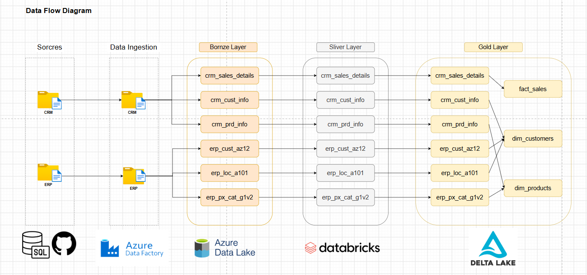
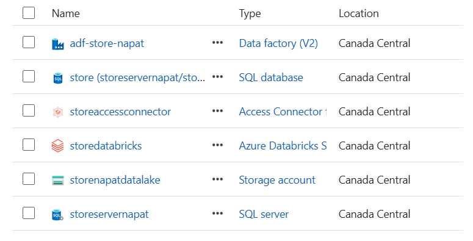

# Azure-Data-Engineering-Project

## 📌 Project Overview
This project focuses on building a comprehensive data engineering pipeline using Azure Data Factory, Azure Databricks, and PySpark. It leverages modern cloud technologies and best practices to ensure efficient data processing and governance.

I will use unclean datasets from [DataWithBaraa's Databricks Bootcamp 2026](https://github.com/DataWithBaraa/databricks_bootcamp_2026/tree/main/datasets/engineering) to better demonstrate the data cleaning and transformation process.
  


---

## 🔑 Key Components
- **Azure Data Factory:** Orchestrates data workflows.
- **Databricks & PySpark:** Enables scalable data transformations.
- **Unity Catalog:** Implements data governance and access control.
- **Delta Lake & Delta Tables:** Provides efficient and reliable data storage.
- **Medallion Architecture:** Structures data pipelines into Bronze, Silver, and Gold layers.
- **Dimensional Data Modeling in Azure Databricks:** Designs and optimizes data warehouses.

---

## 🏗️ Architecture Overview
This project follows the **Medallion Architecture**:
1. **Bronze Layer:** Raw data ingestion from multiple sources.
2. **Silver Layer:** Cleansing and transformation of data.
3. **Gold Layer:** Business-ready, analytics-optimized data.

---

## 📂 Project Folder Structure

```
azure-data-engineering-project/
│
├── AzureDataFactory/
│   ├── dataset/
│   ├── factory/
│   ├── linkedService/
│   ├── pipeline/
│   └── publish_config.json
│
├── AzureDatabricks/
│   ├── gold_layer/
│   ├── silver_layer/
│   └── db_notebook.ipynb
│
├── Picture/
│   ├── data_flow_diagram.png
│   ├── data_mart.png
│   ├── increm_data_pipeline.png
│   ├── integration_model.png
│   ├── resource_group.png
│   └── source_prep_pipeline.png
│
└── README.md
```

---

## 🔄 Data Pipeline Details

### 1️⃣ Data Ingestion (ADF)

* Extracts data from github
* Uses Copy Activity
* Loads raw data into a SQL database (for better data inspection), then ingests it into the Bronze Layer in ADLS Gen2.

### 2️⃣ Bronze Layer

* Raw, unprocessed data
* Stored in Bronze Layer ADLS Gen2

### 3️⃣ Silver Layer (Databricks) 
(Note: The examples below illustrate some of the data transformation steps performed in the Silver Layer. Due to unclean datasets, there are too many transformations to list here.)
* Data cleansing
* Schema enforcement
* Data type corrections
* Deduplication
* Stored in Silver Layer ADLS Gen2

### 4️⃣ Gold Layer (Databricks)

* Business-level aggregations
* Analytical-ready datasets
* Optimized for reporting
* Stored in Gold Layer ADLS Gen2 and Databricks Gold catalog (for initial load and incremental load)

---

## 🚀 How to Run This Project

### Prerequisites

* Azure Subscription
* SQL Server & SQL database (on-premise or VM)
* Azure Data Factory 
* Azure Databricks Workspace & Access Connector for Azure Databricks
* Azure Data Lake Storage Gen2

### Steps

1. Create Azure resources
2. Configure Linked Services in ADF
3. Run ADF pipelines
4. Execute Databricks notebooks (Bronze → Silver → Gold)


